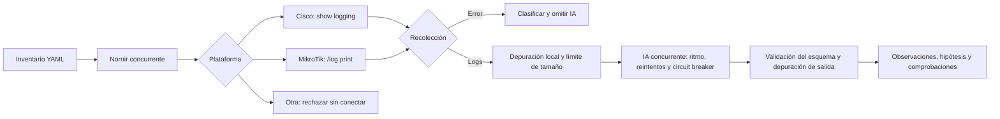

# AIOps Network Automation Engine

Prototipo de automatización de redes que recolecta logs Cisco IOS y MikroTik RouterOS de forma concurrente y ofrece análisis heurístico opcional mediante Gemini. Incluye pruebas simuladas, límites de solicitudes y recuperación ante fallos del proveedor. Las hipótesis requieren validación humana. No se han medido mejoras de MTTR ni capacidad predictiva.

## Flujo actual

Un fallo de Gemini no implica un fallo de red. El circuit breaker usa estados cerrado, abierto y semiabierto, con una sola prueba de recuperación. Las variables de entorno separan credenciales del código; no constituyen una bóveda ni una arquitectura Zero Trust.

## Pruebas sin equipos ni API

Desde la raíz del repositorio, con Python 3.12 en Windows (también se verifica 3.11):

1. Crear entorno: `py -3.12 -m venv .venv`.
2. Activar en PowerShell: `.venv\Scripts\Activate.ps1`.
3. Instalar: `python -m pip install --require-hashes -r requirements-dev.lock.txt`.
4. Probar: `python -m pytest -q`.

Las pruebas usan Nornir y el SDK Gemini reales con transporte HTTP simulado, además de dobles unitarios. Bloquean conexiones de socket y usan credenciales ficticias. Cubren comandos, errores, filtrado de datos, cuerpo HTTP, configuración de timeout, esquemas, catálogo, códigos de salida y cierre de conexiones. Para instalar solo la aplicación: `python -m pip install --require-hashes -r requirements.lock.txt`.

## Verificación en GitHub

Cada propuesta de cambios y cada actualización de `main` ejecutan [GitHub Actions](.github/workflows/ci.yml): Ruff revisa estilo y formato, mypy revisa tipos de la aplicación, Actionlint valida el workflow y pytest comprueba el comportamiento en Windows y Linux con Python 3.11 y 3.12. No se proporcionan claves ni se llama a Gemini desde CI.

Las acciones están fijadas por SHA; las dependencias directas e indirectas, por versiones y hashes. Los archivos `requirements*.txt` declaran las dependencias; `requirements*.lock.txt` contienen la resolución reproducible. Véase [la documentación técnica](docs/OPERACION_Y_VALIDACION.md) para reproducir los controles y actualizar el bloqueo.

## Laboratorio

El inventario es ilustrativo; sustituirlo solo por equipos de laboratorio autorizados. Copiar `.env.example` a `.env` y configurar `NET_USER`, `NET_PASSWORD`, `AI_API_KEY` y `AI_MODEL`. El entorno tiene prioridad sobre `.env`.

`AI_MODEL=gemini-3.5-flash-lite` fue verificado con una inferencia sintética real. `gemini-3.8-flash` presentó alta demanda y fallos transitorios durante la prueba; no hay cambio automático de modelo. Disponibilidad y cuotas requieren seguimiento. `python check_models.py` lista el catálogo; no demuestra que una inferencia funcione.

Ejecutar `python -m src.run_engine` para recolectar y analizar. Los logs depurados se envían al proveedor cuando se configuran las variables de IA. El filtro reconoce patrones y valores conocidos, pero no garantiza anonimización completa: mantener telemetría sintética hasta evaluar la política corporativa de datos. Omitir `AI_API_KEY` permite recolectar sin solicitar inferencia.

`python check_models.py --probe` realiza una inferencia real con un evento sintético fijo y devuelve 0 si la respuesta cumple el esquema, o 1 si falla. Consume API/cuota; no se ejecuta en las pruebas ni usa el inventario. El catálogo sin `--probe` tampoco certifica acceso efectivo.

| Variable | Valor por defecto | Límite |
|---|---|---|
| `AI_TIMEOUT_MS` | 20000 | 1000–120000 ms, timeout HTTP; no es plazo global del proceso. |
| `AI_MAX_PAYLOAD_CHARS` | 8000 | 256–32000 caracteres depurados. Se rechaza exceso; no se trunca. |

Se rechaza entrada original mayor de 65536 caracteres y claves privadas PEM. Cada intento HTTP desactiva reintentos internos; el coordinador permite hasta `1 + AI_MAX_RETRIES` intentos solo ante errores transitorios. Las respuestas distinguen observaciones interpretadas, hipótesis no confirmadas y comprobaciones humanas, sin ejecutar acciones. Véanse [los contratos y límites](docs/OPERACION_Y_VALIDACION.md).

| Salida | Significado |
|---|---|
| 0 | Recolección e inferencia completadas; no certifica la veracidad del diagnóstico. |
| 1 | Error de configuración, ejecución general o cierre de conexiones. |
| 2 | Falló recolección; los análisis de los nodos recolectados fueron satisfactorios. |
| 3 | Recolección correcta; al menos un análisis falló o se omitió por protección. |
| 4 | Fallos tanto de recolección como de análisis. |

## Límites y siguientes fases

- SDK migrado a `google-genai==2.29.0`, con `pydantic==2.14.0` y `httpx==0.28.1`. Contrato HTTP validado localmente e inferencia sintética real exitosa con Flash-Lite.
- Netmiko fijado en la versión resuelta localmente (`4.1.2`); no se recomienda mantenerla como versión de producción sin revisión.
- Dependencias indirectas bloqueadas; su modernización sigue pendiente. Python 3.13 no está soportado por este stack de red, que todavía importa `telnetlib`.
- Concurrencia y ritmo limitados por proceso; el límite debe ajustarse a la cuota real. Varias instancias no comparten cuota ni circuit breaker.
- Faltan pruebas con equipos reales y detección de rechazos CLI. La demo es sintética y no demuestra MTTR ni rendimiento empresarial.

Consultar [la operación y evidencia de validación](docs/OPERACION_Y_VALIDACION.md).

## Resiliencia y evidencia

- `AI_WORKERS=3`: máximo de trabajos concurrentes y futures pendientes.
- `AI_REQUESTS_PER_MINUTE=30`: espaciado de solicitudes, incluidos reintentos.
- `AI_FAILURE_THRESHOLD=3` y `AI_RECOVERY_SECONDS=30`: apertura tras fallos transitorios desde el último éxito y espera antes de una única prueba de recuperación.
- `AI_MAX_RETRIES=1` y `AI_RETRY_DELAY_MS=1000`: reintentos acotados con espera exponencial.
- `AI_ADMISSION_TIMEOUT_SECONDS=60`: limita espera para admitir intentos; no es plazo global ni cancela solicitudes en curso.
- `Retry-After` aplaza admisiones compartidas. Los errores 400/401/403/404 y de datos/esquema no se reintentan.

Las conexiones SSH se cierran antes de esperar por cuota o inferencia.

Demo sin clave ni red: `python -m scripts.demo_resilience`. Actualiza `docs/DEMO_RESULTS.json` con la medición local. Véanse [los controles de resiliencia](docs/OPERACION_Y_VALIDACION.md), [resultados de simulación](docs/DEMO_RESULTS.json) y [prueba real exitosa](docs/REAL_PROBE_ALTERNATE.json).
