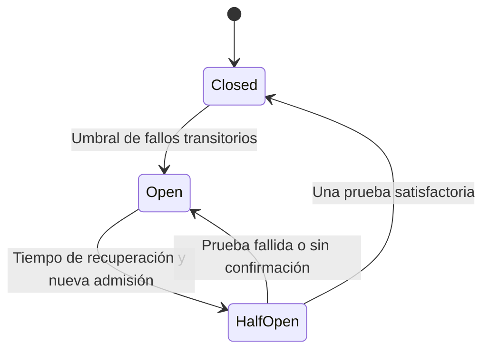

# Fase 3: concurrencia, cuotas y recuperación

Fecha de verificación: 9 de octubre de 2026, Guatemala.

## Comportamiento implementado

Los logs recolectados se depuran y analizan con un máximo configurable de trabajadores. El coordinador mantiene como máximo ese mismo número de futures pendientes; repone trabajos cuando termina uno y presenta resultados en orden del inventario. Las conexiones SSH se cierran antes de las esperas de IA.

Cada análisis tiene estado tipado, mensaje y número de intentos. Las decisiones de reintento y salida del proceso usan estados, sin interpretar prefijos del texto. La función de compatibilidad conserva una respuesta de texto para consumidores anteriores.

| Componente | Decisión | Valor empresarial |
|---|---|---|
| `analysis_result.py` | Estados de IA independientes del resultado de red. | Permite distinguir degradación del proveedor de fallos de infraestructura. |
| `ai_resilience.py` | Trabajadores y futures acotados, espaciado global por proceso. | Evita enviar todos los nodos simultáneamente y reduce ráfagas de cuota. |
| Circuit breaker | Estados sincronizados y generaciones de permisos. | Una respuesta antigua no puede cerrar un circuito recién abierto. |
| Admisión y Retry-After | Pausa compartida, presupuesto de espera y reintentos limitados. | Respeta instrucciones de espera del proveedor y evita bucles de gasto. |
| `run_engine.py` | Cierra SSH antes de IA y asigna códigos distintos a fallos de red/IA. | Facilita supervisión automática sin mantener sesiones de red durante esperas de cuota. |
| Esquema de Gemini | Se omite el campo rechazado por la API y se conserva validación local estricta. | Se corrige un fallo real de interoperabilidad sin aceptar campos inesperados. |

## Configuración

| Variable | Valor inicial | Rango |
|---|---|---|
| `AI_WORKERS` | 3 | 1–16 |
| `AI_REQUESTS_PER_MINUTE` | 30 | 1–6000 |
| `AI_FAILURE_THRESHOLD` | 3 | 1–20 |
| `AI_RECOVERY_SECONDS` | 30 | 1–3600 |
| `AI_MAX_RETRIES` | 1 | 0–2 |
| `AI_RETRY_DELAY_MS` | 1000 | 1–30000 |
| `AI_ADMISSION_TIMEOUT_SECONDS` | 60 | 1–600 |

El ritmo espacia el inicio de intentos por `60 / RPM` segundos y cuenta también reintentos. Se debe ajustar a la cuota real del proyecto; no limita tokens por minuto ni solicitudes realizadas por otros programas.

El SDK realiza un intento HTTP por llamada. El coordinador admite hasta `1 + AI_MAX_RETRIES` llamadas por nodo, con espera exponencial. Solo se reintentan timeout, errores de transporte, HTTP 429 y HTTP 5xx. Fallos de acceso, modelo, solicitud, configuración, entrada y esquema no se reintentan.

`Retry-After`, numérico o fecha HTTP, aplaza nuevas admisiones del proceso. Un 429 sin esa cabecera activa una pausa de `AI_RECOVERY_SECONDS`. Si la pausa excede el presupuesto de admisión, se devuelve el último error sin enviar otra solicitud. Los trabajos que todavía no hicieron una solicitud reciben `admission_timeout`.

## Circuit breaker

El umbral cuenta fallos transitorios desde el último éxito. Un éxito reinicia el contador. Fallos locales o permanentes no aumentan ese contador. Se admite una sola prueba en estado semiabierto y no se reintenta esa prueba. Se protegen estado y contador con un lock; una generación identifica permisos y descarta resultados antiguos después de abrir o recuperar el circuito.

Los controles viven en una instancia de `AnalysisPipeline`. No persisten entre ejecuciones independientes ni se coordinan entre máquinas o procesos. Las solicitudes ya admitidas pueden terminar después de la apertura; no se cancelan. Para un despliegue distribuido se necesitaría coordinación externa.

## Límites de tiempo y recursos

El presupuesto de admisión comienza cuando un trabajador inicia el análisis y limita esperas para admitir intentos. `AI_TIMEOUT_MS` limita operaciones HTTP por intento; ninguno de estos parámetros es un plazo global estricto de pared para todo el lote. No se cancela un hilo que ya está realizando una solicitud.

El coordinador limita tareas pendientes, pero Nornir aún almacena los resultados recolectados y la salida final mantiene un resultado por nodo. No se afirma memoria constante ni un límite completo del volumen de recolección.

El cliente se crea y cierra por intento; no se comparte un cliente mutable entre hilos. La reutilización de conexiones puede evaluarse posteriormente. La configuración de IA se valida una sola vez en el orquestador para evitar esperar por ritmo cuando faltan credenciales.

## Salidas del proceso

| Código | Resultado |
|---|---|
| 0 | Recolección e IA completadas. |
| 1 | Fallo general/configuración del orquestador o cierre de conexiones. |
| 2 | Fallos de recolección; los análisis de nodos recolectados fueron satisfactorios. |
| 3 | Recolección correcta; IA fallida u omitida por configuración/protección. |
| 4 | Fallos tanto de recolección como de IA. |

Un diagnóstico estructuralmente válido no garantiza veracidad. El filtro continúa siendo reducción de datos por patrones y requiere revisión corporativa antes de usar telemetría sensible.

## Resultados reales

La clave del ZIP se utilizó con autorización explícita, solo en memoria y con un evento de laboratorio sintético. No se guardó la clave en el proyecto ni se enviaron logs de equipos.

La prueba detectó HTTP 400 por `additional_properties` en el esquema enviado. Se eliminó ese campo en el esquema de la solicitud; la validación local sigue rechazando campos adicionales. Se añadió una regresión que inspecciona el cuerpo HTTP real del SDK.

`gemini-3.8-flash` devolvió HTTP 503 por alta demanda en una solicitud diagnóstica. La comprobación final con ese modelo hizo dos intentos, terminó en `provider_error` y duró 39.38 s; los logs registraron primero timeout y después error de proveedor. El circuito permaneció cerrado porque el umbral era tres fallos y solo se realizaron dos intentos en esa instancia. [Evidencia](REAL_PROBE.json).

La comprobación alternativa con `gemini-3.5-flash-lite` terminó en `ok`, con un intento y 1.73 s. El modelo identificó el cambio de ethernet1 a down y planteó desconexión física o cambio administrativo como hipótesis, con comprobaciones humanas. El ejemplo de configuración utiliza ahora este modelo probado. No se añadió fallback automático entre modelos. [Respuesta depurada](REAL_PROBE_ALTERNATE.json).

En total se realizaron siete intentos externos durante la investigación y la comprobación, incluidos rechazos, timeout y respuesta exitosa. No se consultó facturación ni se calcula un costo a partir de estos resultados.

## Demo reproducible sin API

Ejecutar desde la raíz: `python -m scripts.demo_resilience`.

La demo usa seis eventos y 0.1 s de latencia sintética por evento, con un ritmo de 6000 RPM exclusivo para la simulación. Se midieron 0.594 s con un trabajador y 0.234 s con tres, una relación de 2.54 veces en esta ejecución. No es una métrica de Gemini, red real ni MTTR.

En otra simulación se configuró umbral dos: dos intentos fallaron y los cuatro siguientes se omitieron con `circuit_open`. [Resultados](DEMO_RESULTS.json).

## Trabajo siguiente

CI, análisis estático y bloqueo reproducible de dependencias constituyen la siguiente fase. Siguen pendientes pruebas contra equipos reales, detección de rechazos CLI y una política de datos validada para producción. El proyecto conserva su estado experimental.

## Verificación final

110 pruebas aprobadas en 19.44 s con Python 3.12.10 en Windows. pip check y git diff --check sin errores. Dos advertencias heredadas del stack de red. La revisión de los 34 archivos de proyecto versionados o no ignorados no encontró la clave API utilizada. Las pruebas locales bloquean sockets y usan credenciales ficticias; las solicitudes reales fueron operaciones separadas autorizadas. Los cambios permanecen locales, sin publicación en GitHub.
