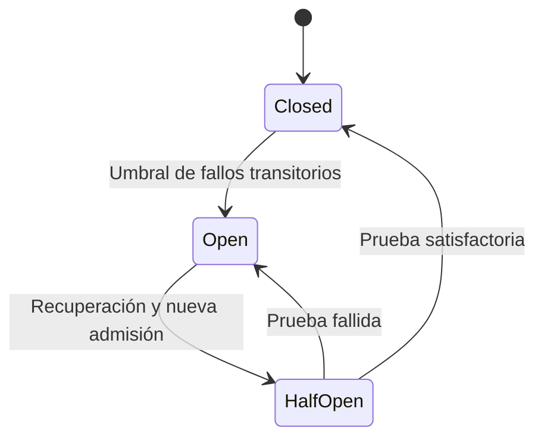

# Operación y validación

## Flujo y alcance

Inventario YAML → recolección concurrente con Nornir/Netmiko → clasificación de errores → cierre SSH → filtrado de datos → análisis concurrente con Gemini → validación de respuesta → resultado y código de salida.

Cisco IOS utiliza `show logging`; MikroTik RouterOS, `/log print`. Una plataforma desconocida se rechaza sin conectar. Los errores de autenticación, timeout y recolección se conservan por separado. Un fallo del proveedor de IA no se interpreta como un fallo de red. No se ejecutan acciones de remediación.

## Instalación y controles

Python soportado: 3.11 y 3.12. Desde la raíz en PowerShell:

```powershell
py -3.12 -m venv .venv
.venv\Scripts\python.exe -m pip install --require-hashes -r requirements-dev.lock.txt
.venv\Scripts\python.exe -m pip check
.venv\Scripts\python.exe -m ruff check .
.venv\Scripts\python.exe -m ruff format --check .
.venv\Scripts\python.exe -m mypy
.venv\Scripts\python.exe -m pytest -q
```

Ruff revisa estilo y formato; mypy revisa aplicación y scripts en modo estricto, omitiendo dependencias externas sin tipos suficientes. Los tests usan credenciales ficticias y bloquean sockets; no consumen API ni conectan dispositivos. Para instalar solo la aplicación, utilizar `requirements.lock.txt`.

CI ejecuta estos controles, Actionlint y cuatro combinaciones Windows/Linux con Python 3.11/3.12. El workflow tiene permisos de lectura, acciones fijadas por SHA y plazo de diez minutos por trabajo. El binario oficial de Actionlint se verifica con SHA256. No hay claves de Gemini en CI.

## Contratos de IA y privacidad

Las variables del entorno tienen prioridad sobre `.env`. `AI_MODEL` se valida como identificador Gemini, pero esta validación no demuestra acceso ni disponibilidad. El cliente se crea y cierra por intento; los reintentos internos del SDK están desactivados.

`AI_TIMEOUT_MS` limita operaciones HTTP por intento: no es un plazo total del lote. `AI_MAX_PAYLOAD_CHARS` limita caracteres depurados, no tokens. Se rechaza entrada original mayor de 65536 caracteres, claves privadas PEM y contenido depurado que exceda el límite; no se trunca silenciosamente.

El filtro elimina valores conocidos de credenciales y nombres de nodos, líneas con patrones de secretos, URLs, correos, direcciones IP/MAC, nombres DNS y patrones de cuentas. También depura la salida. Puede ocultar información útil y no reconoce todos los datos sensibles, identidades o secretos codificados. No constituye DLP ni garantiza anonimización completa. Usar telemetría sintética hasta evaluar una política de datos adecuada.

La respuesta requiere `observations` (1–3), `hypotheses` (0–3) y `checks` (1–3), con textos de 1–600 caracteres y sin campos adicionales. Se solicita un máximo de 1024 tokens y se rechaza texto recibido superior a 16000 caracteres. Respuestas vacías, bloqueadas, incompletas o inválidas se clasifican como fallos de análisis. La instrucción y los datos se envían separados; esto no garantiza resistencia completa a prompt injection. Validar el esquema no demuestra veracidad.

## Coordinación y recuperación

El máximo de trabajadores y futures pendientes es `AI_WORKERS`. La presentación de resultados conserva el orden del inventario. El ritmo espacia admisiones por `60 / AI_REQUESTS_PER_MINUTE` segundos, incluidos reintentos. No limita tokens ni llamadas realizadas por otros procesos.

Solo timeout, errores de transporte, HTTP 429 y HTTP 5xx admiten reintentos, hasta `1 + AI_MAX_RETRIES` llamadas por nodo y con espera exponencial. `Retry-After` aplaza admisiones compartidas; un 429 sin cabecera activa la pausa de recuperación. El presupuesto de admisión limita esperas para iniciar intentos, no cancela una solicitud en curso.



El circuito permite una sola prueba semiabierta. Un éxito reinicia el contador; errores locales o permanentes no lo incrementan. Permisos por generación impiden que una respuesta antigua cierre un circuito recién abierto. Los controles viven por instancia y no coordinan múltiples procesos. Las solicitudes ya admitidas pueden terminar tras la apertura.

Nornir almacena resultados recolectados y la salida conserva un resultado por nodo. No se afirma memoria constante ni un límite completo de volumen de recolección. Los rangos y valores predeterminados están en `.env.example`, `ai_config.py` y `ai_resilience.py`; los códigos de salida están descritos en README.

## Evidencia

El [run verificado](https://github.com/DearDavidZ/aiops-network-automation-engine/actions/runs/38001001818) del commit `b28953e514cca0d4f6e869def0a9f8847714b38a` aprobó los cinco trabajos de CI. El [run anterior](https://github.com/DearDavidZ/aiops-network-automation-engine/actions/runs/38000826671) registró 110 pruebas aprobadas por cada combinación Windows/Linux y Python 3.11/3.12. Para cambios posteriores, consultar sus propios checks.

La [simulación](DEMO_RESULTS.json) comparó un trabajador con tres bajo latencia sintética; no demuestra rendimiento de Gemini, red real ni MTTR. Una [inferencia sintética con Flash-Lite](REAL_PROBE_ALTERNATE.json) fue exitosa en un intento y 1.73 s. La [comprobación con otro modelo](REAL_PROBE.json) falló por errores transitorios. Se corrigió una incompatibilidad del esquema detectada por la API y se conservó validación local estricta. No hay cambio automático de modelo. `check_models.py --probe` consume API y no se ejecuta en CI.

## Mantenimiento y pendientes

Para actualizar dependencias, modificar pins y regenerar ambos bloqueos con la versión de uv fijada:

```powershell
.venv\Scripts\uv.exe pip compile requirements.txt --universal --python-version 3.11 --generate-hashes --output-file requirements.lock.txt
.venv\Scripts\uv.exe pip compile requirements-dev.txt --universal --python-version 3.11 --generate-hashes --output-file requirements-dev.lock.txt
```

Instalar los bloqueos en un entorno nuevo y repetir controles. Los hashes no constituyen una auditoría de seguridad. Siguen pendientes validación con routers reales, detección de rechazos CLI, modernización del stack de red y política de datos. Las advertencias de `pkg_resources` y `telnetlib` son conocidas; Python 3.13 no está soportado. El alcance permanece experimental.

Referencias: [SDK de Google](https://googleapis.github.io/python-genai/), [uv y bloqueos](https://docs.astral.sh/uv/pip/compile/), [Actionlint](https://github.com/rhysd/actionlint/releases/tag/v1.7.12).
